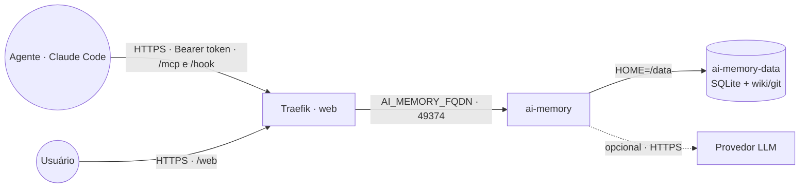
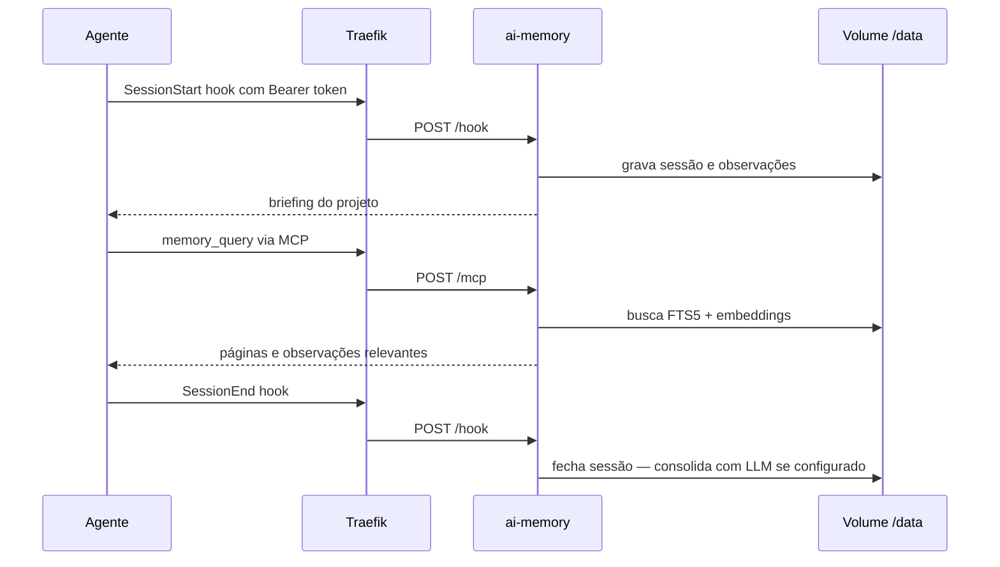

# ai-memory — memória de longo prazo para agentes

Servidor do [ai-memory](https://github.com/akitaonrails/ai-memory): memória persistente entre
sessões para agentes de código (Claude Code, Codex, OpenCode, Gemini CLI, Cursor…) via **MCP**
e **hooks**. Os hooks capturam prompts, chamadas de ferramenta e fim de sessão; o servidor guarda
tudo num SQLite + wiki markdown versionado em git e responde às ferramentas MCP (`memory_query`,
`memory_briefing`, handoffs etc.).

Usa a imagem oficial `akitaonrails/ai-memory` (amd64/arm64). O servidor escuta na porta
**49374** e é exposto via Traefik com TLS. Endpoints no `AI_MEMORY_FQDN`:

| Caminho | Uso |
|---|---|
| `/mcp` | MCP Streamable HTTP (ferramentas do agente) |
| `/hook` | ingestão dos hooks do agente |
| `/web` | UI read-only da wiki (login: qualquer usuário + o token como senha) |
| `/healthz` | health check |

**Modo padrão = zero-LLM:** captura + busca FTS5 funcionam sem nenhum provedor. Na primeira
subida o servidor baixa um modelo local de embeddings (~87 MB, em `/data/models`); a busca
híbrida liga no **próximo** start do serviço. LLM (consolidação de sessões em páginas) é opcional.

## Arquitetura



O TLS termina no Traefik; o ai-memory fala HTTP só dentro da rede. `AI_MEMORY_ALLOWED_HOSTS`
(montado a partir do `AI_MEMORY_FQDN`) bloqueia requisições com outro `Host` (DNS rebinding).

## Fluxo



## Variáveis de ambiente

| Variável | Obrigatória | Default | Descrição |
|---|---|---|---|
| `AI_MEMORY_FQDN` | Sim | — | Domínio público (ex.: `memory.exemplo.com`) |
| `AI_MEMORY_AUTH_TOKEN` | Sim | — | Bearer token dos clientes e senha da UI `/web`. Gere com `openssl rand -hex 32` |
| `AI_MEMORY_IMAGE_TAG` | Não | `latest` | Tag da imagem upstream (ex.: `3.3.1` para fixar/rollback) |
| `AI_MEMORY_LLM_PROVIDER` | Não | vazio | Vazio = zero-LLM. `anthropic`, `openai` ou `openai-compat` |
| `AI_MEMORY_LLM_MODEL` | Não | vazio | Modelo; vazio = default do provedor (`claude-haiku-4-5`, `gpt-5.4-mini`) |
| `AI_MEMORY_LLM_BASE_URL` | Não | vazio | Endpoint do `openai-compat` (OpenRouter, Ollama, vLLM, LiteLLM…) |
| `ANTHROPIC_API_KEY` | Não | vazio | Chave do provedor `anthropic` |
| `OPENAI_API_KEY` | Não | vazio | Chave do provedor `openai` |
| `LLM_API_KEY` | Não | vazio | Chave do provedor `openai-compat` |
| `AI_MEMORY_RUST_LOG` | Não | `ai_memory=info,…` | Nível de log (`RUST_LOG`) |
| `PROXY_NET` | Não | `web` | Nome da rede externa do Traefik |
| `WORKER_HOSTNAME` | Não | — | Fixa o nó em cluster multi-worker (volume é local ao nó) |

> O provedor `anthropic-oauth` (assinatura Claude) existe no upstream, mas a Anthropic recusa
> esses tokens vindos de apps de terceiros (429). Para consolidação, use uma API key.

## Pré-requisitos

- Rede externa `web` com Traefik v3 (certresolver `letsencryptresolver`).
- DNS do `AI_MEMORY_FQDN` apontando para o proxy.
- Um token longo e aleatório para `AI_MEMORY_AUTH_TOKEN`.

## Uso

1. Deploy pela App Template do Portainer (ou `docker stack deploy`), informando
   `AI_MEMORY_FQDN` e `AI_MEMORY_AUTH_TOKEN`.
2. Conferir: `curl -s https://<AI_MEMORY_FQDN>/healthz` → `200`; e `POST /mcp` sem token → `401`.
3. **Em cada máquina com o agente**, instale o CLI do ai-memory
   ([instruções upstream](https://github.com/akitaonrails/ai-memory/blob/main/docs/install.md#server-on-a-different-machine))
   e aponte para o servidor:
   ```bash
   export AI_MEMORY_SERVER_URL="https://<AI_MEMORY_FQDN>"
   export AI_MEMORY_AUTH_TOKEN="<token>"
   ai-memory install-mcp   --client claude-code --apply
   ai-memory install-hooks --agent  claude-code --apply
   ```
   Deixe as duas variáveis no `~/.zshrc`/`~/.bashrc` (ou direnv) para os hooks as enxergarem.
4. UI: `https://<AI_MEMORY_FQDN>/web` — qualquer usuário, senha = token.
5. Para ligar a busca híbrida após o download do modelo de embeddings, reinicie o serviço uma vez
   (o log avisa `hybrid search enables on the next start`).

### Migrar dados de uma instalação local

Os dados ficam todos no volume `ai-memory-data` (`/data`). Para trazer uma instalação existente,
pare as duas pontas e copie o conteúdo do volume antigo para o novo (no nó onde o volume vive):

```bash
docker run --rm -v <volume-antigo>:/from:ro -v ai-memory_ai-memory-data:/to alpine \
  sh -c 'cp -a /from/. /to/ && chown -R 1000:999 /to'
```

Se o `/data/config.toml` antigo apontar o token para um arquivo do host, remova essa entrada —
na stack o token vem de `AI_MEMORY_AUTH_TOKEN`.

## Segurança

- **Token obrigatório**: com `AI_MEMORY_AUTH_TOKEN` vazio o ai-memory sobe **sem autenticação**
  (só avisa no log) — por isso o compose usa `${AI_MEMORY_AUTH_TOKEN:?}` e o deploy falha sem ele.
  Trate-o como segredo — quem tem o token lê e escreve toda a memória.
- O volume guarda prompts e trechos de código capturados (já sanitizados pelo ai-memory); trate o
  nó e os backups como sensíveis.
- `AI_MEMORY_AUTH__SECURE_COOKIE=true` está fixo: o cookie da UI só trafega em HTTPS (Traefik).
  Não acesse o serviço por HTTP direto.

## Troubleshooting

| Sintoma | Causa provável | Ação |
|---|---|---|
| `403` em todas as rotas | `Host` fora do allowlist | conferir se o acesso usa exatamente o `AI_MEMORY_FQDN` |
| `401` em `/mcp` ou `/hook` | token ausente/diferente no cliente | conferir `AI_MEMORY_AUTH_TOKEN` no cliente e na stack |
| Deploy falha com `required variable AI_MEMORY_AUTH_TOKEN is missing` | token não informado | definir o token (proposital: sem ele o servidor ficaria aberto) |
| 404 no Traefik | serviço fora da `web` ou label ausente | conferir `deploy.labels` e a rede `web` |
| 502 / Bad Gateway | serviço ainda subindo / porta errada | conferir porta interna `49374` e o status da task |
| Busca sem embeddings | modelo baixado mas serviço não reiniciado | reiniciar o serviço uma vez |
| `memory_consolidate disabled` no log | sem provedor LLM (modo zero-LLM) | normal; defina `AI_MEMORY_LLM_PROVIDER` + chave para consolidar |
