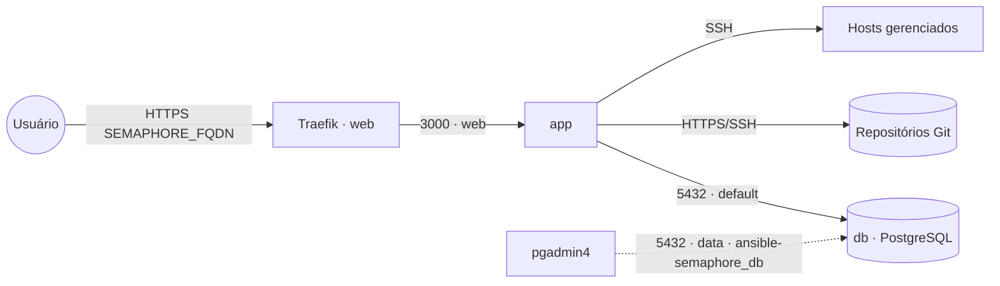
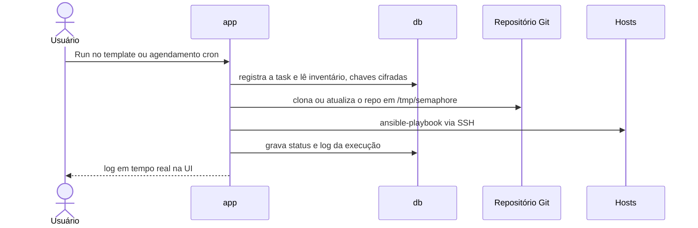

# ansible-semaphore — Semaphore UI

**Semaphore UI** — interface web + API para rodar **Ansible** (e também Terraform/OpenTofu,
PowerShell e Bash): projetos, inventários, repositórios Git, chaves SSH/segredos, templates de
tarefa, agendamentos (cron) e histórico de execuções com log. Publicado via Traefik v3 com TLS, com
**PostgreSQL embarcado** (serviço `db` próprio da stack).

| Serviço | Imagem | Função |
|---|---|---|
| `app` | `semaphoreui/semaphore` | UI/API web (porta 3000) + runner das tasks (Ansible já incluso na imagem) |
| `db` | `postgres:16-alpine` | banco próprio da stack (projetos, usuários, histórico, chaves cifradas) |

## Arquitetura

## Fluxo de uma execução

## Variáveis de ambiente
| Variável | Obrigatória | Default | Descrição |
|---|---|---|---|
| `SEMAPHORE_FQDN` | sim | — | domínio público (ex.: `semaphore.exemplo.com`); também vira `SEMAPHORE_WEB_ROOT` |
| `SEMAPHORE_DB_PASSWORD` | sim | — | senha do PostgreSQL (usada pelo app e pelo `db`) |
| `SEMAPHORE_ADMIN_PASSWORD` | sim | — | senha do admin criado na 1ª subida |
| `SEMAPHORE_ADMIN_EMAIL` | sim | — | e-mail do admin |
| `SEMAPHORE_ACCESS_KEY_ENCRYPTION` | sim | — | chave que cifra as chaves/segredos salvos. Gere com `head -c32 /dev/urandom \| base64`. **Não troque depois** (perde o acesso às chaves já salvas) |
| `SEMAPHORE_ADMIN` | não | `admin` | login do admin |
| `SEMAPHORE_ADMIN_NAME` | não | `Admin` | nome exibido do admin |
| `SEMAPHORE_DB_HOST` | não | `db` | host do banco (serviço interno desta stack) |
| `SEMAPHORE_DB_PORT` | não | `5432` | porta do PostgreSQL |
| `SEMAPHORE_DB_USER` | não | `semaphore` | usuário do banco |
| `SEMAPHORE_DB_NAME` | não | `semaphore` | nome do banco |
| `TZ` | não | `America/Sao_Paulo` | fuso dos agendamentos (`SEMAPHORE_SCHEDULE_TIMEZONE`) e logs |
| `SEMAPHORE_IMAGE_TAG` | não | `v2.19.17` | tag da imagem `semaphoreui/semaphore` (o upstream não publica tag de major; fixe a versão) |
| `SEMAPHORE_DB_IMAGE_TAG` | não | `16-alpine` | tag da imagem PostgreSQL |
| `PROXY_NET` | não | `web` | rede externa do Traefik |
| `DATA_NET` | não | `data` | rede externa p/ ferramentas de admin alcançarem o banco |
| `WORKER_HOSTNAME` | não | — | nó para fixar os serviços (Swarm multi-worker; descomente o constraint) |

## Pré-requisitos
- **Hardware mínimo:** 1 vCPU · 512 MB RAM · 5 GB disco
- **Hardware ideal:** 2 vCPU · 1 GB RAM · 20 GB disco (playbooks pesados/paralelos pedem mais)
- Stack `balancer` (Traefik) + rede `web`; DNS de `SEMAPHORE_FQDN` apontando para o host.
- Rede `data` (`docker network create --driver overlay --attachable data`) — só é usada se você
  descomentar `- data` no `db` para administrá-lo pelo `pgadmin4`.
- **Não** precisa da stack `postgres-pgvector`: o banco sobe junto.
- Os hosts gerenciados precisam ser alcançáveis por SSH **a partir do nó** onde o `app` roda.

## Uso
1. Gere a chave de cifra: `head -c32 /dev/urandom | base64`.
2. Faça o deploy informando as variáveis obrigatórias. Banco, usuário e admin são criados na
   primeira subida.
3. Acesse `https://SEMAPHORE_FQDN` e entre com `SEMAPHORE_ADMIN` / `SEMAPHORE_ADMIN_PASSWORD`.
4. Crie um **Project** → cadastre em **Key Store** a chave SSH (dos hosts e/ou do Git) →
   **Repositories** → **Inventory** → **Task Templates** e rode/agende.

### Acesso direto sem proxy (standalone)
Na variante standalone há um bloco `ports:` comentado (`SEMAPHORE_EXTERNAL_PORT:-3000`) para expor a
UI direto no host, sem Traefik. Só use em rede confiável: a UI controla execução remota nos seus hosts.

### Migrar para outro host
Migre os volumes `semaphore-postgres-data` (todo o estado) e, opcionalmente, `semaphore-data`
(clones dos repositórios — são refeitos sozinhos) e suba a stack lá com **a mesma**
`SEMAPHORE_ACCESS_KEY_ENCRYPTION`. Os nomes de volume coincidem com os de um deploy feito como
projeto `ansible-semaphore` (`ansible-semaphore_semaphore-postgres-data`), então redeployar com esse
nome de stack reaproveita os volumes existentes.

## Troubleshooting
| Sintoma | Causa | Ação |
|---|---|---|
| `app` reinicia com erro de conexão ao banco | `db` ainda subindo / senha divergente | aguardar o `db`; conferir `SEMAPHORE_DB_PASSWORD` igual no app e no banco |
| Login do admin não funciona após mudar a env | o admin só é criado na 1ª subida | trocar a senha pela UI (ou `semaphore user change-by-login` dentro do container) |
| Chaves salvas não decifram / tasks falham ao usar a key | `SEMAPHORE_ACCESS_KEY_ENCRYPTION` trocada | voltar a chave original (ela não pode mudar depois do 1º uso) |
| Links dos e-mails/notificações apontam para `localhost` | `SEMAPHORE_WEB_ROOT` errado | conferir `SEMAPHORE_FQDN` |
| Task falha com `UNREACHABLE` | host não alcançável por SSH a partir do nó | testar SSH de dentro do container (`docker exec ... ssh`) e a chave no Key Store |
| 404/sem TLS | fora da `web` / DNS não aponta | conferir rede/labels e DNS |
| pgadmin4 não acha o banco | `db` fora da `data` | descomentar `- data` no `db` e usar `ansible-semaphore_db:5432` |
