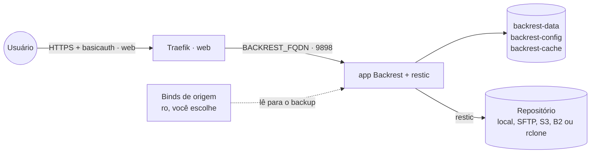
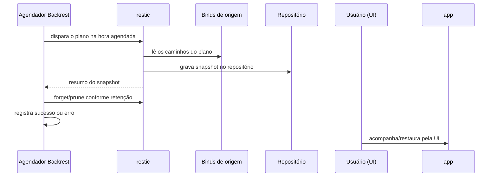

# backrest — UI e agendador do restic

[Backrest](https://github.com/garethgeorge/backrest) é uma UI web + agendador para o
[restic](https://restic.net/): cria planos de backup (origem, agenda, retenção), roda prune/check
periódicos e gerencia um ou mais repositórios (local, SFTP, S3, Backblaze B2, ou qualquer backend
via rclone). Publicado via **Traefik v3** com TLS Let's Encrypt e protegido por **basicauth**: o
Backrest só cria o usuário/senha próprios no *primeiro acesso* à UI, então sem o basicauth na
frente qualquer um que chegasse no `BACKREST_FQDN` antes de você poderia criar essa conta (e
assumir a configuração dos seus backups).

Por padrão a stack **não monta nenhuma origem** — ela só traz o serviço com volumes para os próprios
dados do Backrest (`data`, `config`, `cache`). Você decide o que ele vê adicionando binds no serviço
`app` (veja [Pré-requisitos](#pré-requisitos)).

## Arquitetura



## Fluxo

Backup de um plano, agendado pelo próprio Backrest:



## Variáveis de ambiente

| Variável | Obrigatória | Default | Descrição |
|---|---|---|---|
| `BACKREST_FQDN` | sim | — | domínio público (ex.: `backup.exemplo.com`) |
| `BACKREST_AUTH_BASIC` | sim | — | basicauth do Traefik `usuario:hash_bcrypt` (`htpasswd -nbB`) — protege o 1º acesso |
| `TZ` | não | `America/Sao_Paulo` | fuso horário dos agendamentos |
| `BACKREST_HOSTNAME` | não | `backrest` | nome gravado como host nos snapshots do restic |
| `BACKREST_IMAGE_TAG` | não | `latest` | tag de `garethgeorge/backrest` |
| `BACKREST_EXTERNAL_PORT` | não | `8169` | porta de acesso direto (bypass do Traefik), se descomentada |
| `PROXY_NET` | não | `web` | nome da rede externa do proxy |

## Pré-requisitos

1. Rede externa do proxy: `docker network create web` (standalone) ou
   `docker network create --driver overlay --attachable web` (Swarm).
2. Stack `balancer` (Traefik) rodando e DNS de `BACKREST_FQDN` apontando para o host.
3. **Basicauth**: gere o usuário/hash com `htpasswd -nbB usuario senha` e informe o resultado
   (`usuario:hash_bcrypt`) em `BACKREST_AUTH_BASIC`. Sem isso o Traefik responde `401` em qualquer
   acesso — é intencional, protege o primeiro login até você criar a conta própria do Backrest.
4. **Binds de origem**: edite o `docker-compose.yml`/`docker-compose.standalone.yml` e descomente
   (ou adicione) em `volumes:` do serviço `app` os caminhos do host que o Backrest deve conseguir
   ver, sempre `:ro` (ele só precisa ler para fazer o backup):
   ```yaml
   volumes:
     - /home:/sources/home:ro
     - /var/lib/docker/volumes:/sources/docker-volumes:ro
   ```
   Depois, na UI, aponte o plano para `/sources/...`.
5. **Repositório** (destino do backup): configurado pela UI, não por env var. Pode ser local
   (monte um bind/volume extra para o disco de destino, ex.: `/mnt/backup:/repos/backup`), ou remoto
   (SFTP, S3, B2) direto na UI, ou via rclone (monte `backrest-rclone-config` em
   `/root/.config/rclone` e rode `rclone config` dentro do container antes de criar o repo na UI).

## Uso

1. Suba a stack informando `BACKREST_FQDN`, `BACKREST_AUTH_BASIC` (e os binds de origem, se quiser).
2. Acesse `https://BACKREST_FQDN`: o navegador primeiro pede o basicauth do Traefik (usuário/senha
   que você gerou com `htpasswd`), depois cai na tela de **criar o usuário/senha da própria UI do
   Backrest** — faça isso na hora, é essa segunda conta que fica valendo depois.
3. Crie o repositório (Settings → Repos) e um plano (Add Plan): origem (`/sources/...`), agenda
   (cron) e política de retenção.
4. Acompanhe os backups pela UI; restaure por ali também (Snapshot → Restore).

**Backup / migrar de host:** pare a stack e copie os volumes `backrest-data` e `backrest-config`
(o `backrest-cache` é descartável). O repositório restic em si (fora destes volumes) tem sua
própria cópia de segurança — sem a senha do repositório (gerada ao criá-lo na UI) os snapshots não
são recuperáveis, guarde-a fora deste host.

## Troubleshooting

| Sintoma | Causa | Ação |
|---|---|---|
| `401 Unauthorized` ao abrir `BACKREST_FQDN` | basicauth do Traefik (esperado) | informe o usuário/senha gerados com `htpasswd` em `BACKREST_AUTH_BASIC` |
| Plano falha com caminho não encontrado | origem não montada no serviço `app` | adicione o bind em `volumes:` (veja Pré-requisitos) e redeploy |
| Backup de volume Docker fica inconsistente (banco) | volume copiado com o serviço rodando | faça um dump do banco antes do backup, ou pare o serviço na janela do backup |
| 404 / certificado inválido | DNS de `BACKREST_FQDN` não aponta para o host, ou `PROXY_NET` errado | confira DNS e a rede do proxy |
| Perdeu acesso à UI (senha) | sem reset de senha pela UI sem login | apague `config/config.json` do volume `backrest-config` para recriar o 1º acesso (perde os planos, não os snapshots já gravados no repositório) |
| Repositório "não pode ser aberto" | senha do repositório diferente da usada ao criá-lo | confirme a senha guardada fora do host; sem ela os snapshots não são recuperáveis |
