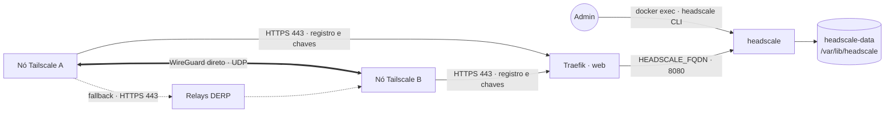
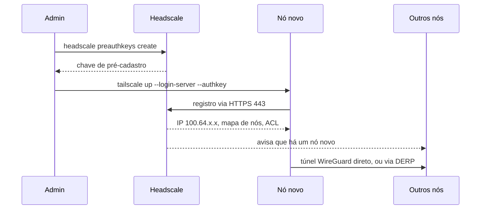

# headscale — servidor de coordenação Tailscale auto-hospedado

[Headscale](https://github.com/juanfont/headscale) é a implementação open source do servidor de
coordenação do Tailscale. Os nós usam o **cliente oficial do Tailscale** apontando para este
servidor: ele cadastra as máquinas, distribui as chaves WireGuard, atribui os IPs
(`100.64.0.0/10`), resolve nomes (MagicDNS) e aplica as ACLs. Publicado via **Traefik v3** com TLS
Let's Encrypt.

O **tráfego da VPN não passa por aqui**: vai direto entre os nós (WireGuard, furando NAT) ou, se a
conexão direta falhar, por um relay **DERP** (os públicos do Tailscale ou o embutido, opcional).

Um serviço, um volume: banco SQLite e chaves ficam em `headscale-data` → `/var/lib/headscale`.
Configuração **só por env** (`HEADSCALE_<SEÇÃO>_<CHAVE>`, sem arquivo de config) e ACLs **no banco**
(`policy.mode=database`).

## Arquitetura



## Fluxo



## Variáveis de ambiente

| Variável | Obrigatória | Default | Descrição |
|---|---|---|---|
| `HEADSCALE_FQDN` | sim | — | domínio público (ex.: `vpn.exemplo.com`); vira `server_url=https://<FQDN>` |
| `HEADSCALE_BASE_DOMAIN` | não | `vpn.internal` | domínio MagicDNS dos nós (`<host>.vpn.internal`); **diferente** do FQDN |
| `HEADSCALE_PREFIX_V4` / `HEADSCALE_PREFIX_V6` | não | `100.64.0.0/10` / `fd7a:115c:a1e0::/48` | faixas de IP dos nós |
| `HEADSCALE_DERP_SERVER_ENABLED` | não | `false` | liga o relay DERP embutido (ver abaixo) |
| `HEADSCALE_DERP_SERVER_IPV4` | não | — | IPv4 público do host (só com DERP embutido) |
| `HEADSCALE_LOG_LEVEL` | não | `info` | `debug`, `info`, `warn`, `error` |
| `HEADSCALE_IMAGE_TAG` | não | `0.29` | tag de `headscale/headscale` — fixe a **minor** (há mudanças incompatíveis entre minors) |
| `PROXY_NET` | não | `web` | rede externa do proxy |

O MagicDNS **não sobrescreve** o DNS local dos nós (`override_local_dns=false`): útil quando os nós
ficam em redes de terceiros.

## Pré-requisitos

1. Rede externa do proxy: `docker network create web` (standalone) ou
   `docker network create --driver overlay --attachable web` (Swarm).
2. Stack `balancer` (Traefik) rodando e DNS de `HEADSCALE_FQDN` apontando para o host (porta 443
   acessível da internet — os nós se registram por ela).

## Uso

Administração pela CLI dentro do container:

```bash
# Swarm: descubra o container no nó onde o serviço roda
HS=$(docker ps -q -f name=headscale_headscale)
# standalone: HS=<nome do container>

docker exec $HS headscale users create suporte
docker exec $HS headscale users list                      # anote o ID
docker exec $HS headscale preauthkeys create -u <ID> -e 1h               # chave de uso único
docker exec $HS headscale preauthkeys create -u <ID> -e 1h --tags tag:servidor   # nó já com tag
docker exec $HS headscale nodes list
```

No nó:

```bash
tailscale up --login-server https://<HEADSCALE_FQDN> --authkey <chave>
```

Ou com o cliente em container (`tailscale/tailscale`, `network_mode: host`, `cap_add: NET_ADMIN`,
`/dev/net/tun`, `TS_AUTHKEY`, `TS_EXTRA_ARGS=--login-server=https://<HEADSCALE_FQDN>`). A chave só é
usada no primeiro cadastro; depois o nó reconecta sozinho (estado em `/var/lib/tailscale`).

### ACLs

Sem política aplicada, **todos os nós falam com todos**. Para restringir, aplique uma política
(exemplo em [`config/policy.example.hujson`](config/policy.example.hujson)):

```bash
docker cp policy.hujson $HS:/tmp/policy.hujson
docker exec $HS headscale policy set -f /tmp/policy.hujson
docker exec $HS headscale policy get
```

### DERP embutido (opcional)

Por padrão os nós usam os relays DERP públicos do Tailscale quando a conexão direta falha (o
tráfego continua criptografado ponta a ponta). Para relay próprio:

1. `HEADSCALE_DERP_SERVER_ENABLED=true` e `HEADSCALE_DERP_SERVER_IPV4=<IP público do host>`;
2. descomentar o bloco `ports:` (STUN `3478/udp`, modo host — o Traefik não roteia UDP) e liberar
   a porta no firewall.

O relay é servido em `https://<HEADSCALE_FQDN>/derp` pelo próprio Traefik.

### Backup

Faça backup do volume `headscale-data` (banco + `noise_private.key`). Perder a chave noise obriga
**todos** os nós a se cadastrarem de novo.

## Troubleshooting

| Sintoma | Causa | Ação |
|---|---|---|
| `Fatal config error ... noise.private_key_path` | env `HEADSCALE_NOISE_PRIVATE_KEY_PATH` removida | restaurar a env do compose |
| Nó não registra (`tailscale up` trava) | DNS do FQDN, porta 443 fechada ou certificado ainda não emitido | `curl -I https://<FQDN>/health` deve responder 200 |
| `unable to connect` / chave rejeitada | pre-auth key expirada ou já usada (uso único) | gerar outra; `--reusable` só se necessário |
| `Clients with a lower minimum version will be rejected` | cliente Tailscale antigo | atualizar o cliente |
| Nós se veem mas o tráfego não passa | ACL bloqueando | `headscale policy get` e revisar `acls` |
| Conexão só via DERP (lenta) | UDP bloqueado na rede do nó | normal em redes restritas; DERP embutido reduz latência |
| `WRN listening without TLS but ServerURL does not start with http://` | TLS terminado no Traefik | esperado, ignorar |
