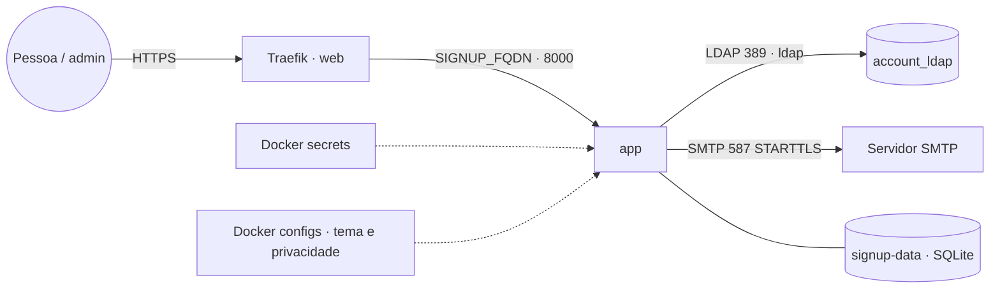

# ldap-self-signup — autocadastro de contas LDAP com aprovação

Autocadastro de contas num diretório **OpenLDAP** (`posixAccount`) com **aprovação de um admin**. Imagem
`ghcr.io/marcelofmatos/ldap-self-signup` ([código](https://github.com/marcelofmatos/ldap-self-signup)).

- Formulário público com confirmação de e-mail e consentimento (LGPD) → painel de aprovação → conta criada no
  LDAP e link para a pessoa definir a senha.
- Convites (individuais, em lote por planilha e por e-mail), confirmação/correção de dados, reset de senha em lote.
- Área do usuário: minha conta, trocar senha, esqueci minha senha, serviços em cards.
- Tema configurável (nome, cores, logo, aviso de privacidade, e-mails).

Combina com a stack [`account`](../account/) (OpenLDAP + LAM), que fornece o diretório na rede `ldap`.

## Arquitetura



- **Estado** em SQLite no volume `/data` (solicitações, consentimentos, tokens de uso único, auditoria): **1
  réplica**, e em cluster com vários workers fixe o nó (`WORKER_HOSTNAME`).
- **Segredos só por arquivo**: senha do bind LDAP, chave da sessão e senha SMTP vêm de Docker secrets
  (`*_FILE`), nunca de variável.
- **Tema** por Docker configs: `privacidade.md` (obrigatório — sem ele o app não sobe) e `tema.toml`.

## Variáveis de ambiente

| Variável | Obrigatória | Default | Descrição |
|---|---|---|---|
| `SIGNUP_FQDN` | sim | — | Domínio público (também vira o `PUBLIC_URL` dos links dos e-mails) |
| `LDAP_BIND_DN` | sim | — | DN de bind com permissão para criar contas e alterar grupos |
| `LDAP_USERS_BASE` | sim | — | Base das contas (ex.: `ou=Users,dc=exemplo,dc=org`) |
| `LDAP_DEFAULT_GROUP_DN` | sim | — | Grupo `posixGroup` padrão das contas novas |
| `ADMIN_GROUP_DN` / `ADMIN_UIDS` | um dos dois | — | Quem entra no painel: membros (`memberUid`) do grupo e/ou lista de uids |
| `SMTP_HOST` | sim | — | Servidor SMTP |
| `SMTP_FROM` | sim | — | Remetente |
| `ADMIN_NOTIFY_EMAIL` | sim | — | Caixa dos avisos de nova solicitação |
| `LDAP_URL` | não | `ldap://account_ldap:389` | Servidor LDAP |
| `LDAP_DEFAULT_GID` | não | `10000` | `gidNumber` das contas novas |
| `SMTP_PORT` / `SMTP_STARTTLS` / `SMTP_USER` | não | `587` / `true` / vazio | SMTP |
| `TOKEN_TTL_HOURS` / `CONVITE_TTL_DIAS` | não | `24` / `7` | Validade dos links |
| `RATE_LIMIT_FORM` / `RATE_LIMIT_LOGIN` | não | `10/hora` / `10/15min` | Limites por IP |
| `TIMEZONE_EXIBICAO` | não | `America/Sao_Paulo` | Fuso das datas |
| `TRUSTED_PROXIES` | não | `1` | Proxies confiáveis no `X-Forwarded-For` |
| `APP_IMAGE_TAG` | não | `latest` | Versão da imagem (fixe uma `x.y.z` em produção) |
| `PROXY_NET` / `LDAP_NET` | não | `web` / `ldap` | Redes externas |
| `SECRET_LDAP_BIND_PW` / `SECRET_SECRET_KEY` / `SECRET_SMTP_PASSWORD` | não | `ldap_self_signup_*` | Nomes dos secrets (Swarm) |
| `PRIVACIDADE_CONFIG_NAME` / `TEMA_CONFIG_NAME` | não | `ldap_self_signup_*_v1` | Nomes dos configs (Swarm) |
| `LDAP_BIND_PW` / `SECRET_KEY` / `SMTP_PASSWORD` | sim no Compose | — | Só no standalone: viram secrets do Compose |
| `SIGNUP_TEMPLATE_DIR` | não | `./template` | Só no standalone: pasta do tema montada em `/template` |

## Pré-requisitos

1. Redes externas `web` (Traefik) e `ldap` (onde está o OpenLDAP — ex.: stack `account`).
2. No LDAP: `LDAP_USERS_BASE` e o grupo `LDAP_DEFAULT_GROUP_DN` existentes; o bind precisa criar entradas e
   alterar `memberUid` do grupo.
3. SMTP funcionando (o domínio do remetente autenticado com SPF/DKIM no provedor).
4. **Swarm** — antes do deploy, criar (Portainer → *Secrets* / *Configs*, ou CLI num manager):
   ```bash
   printf '%s' 'SENHA-DO-BIND'      | docker secret create ldap_self_signup_ldap_bind_pw -
   openssl rand -hex 32 | tr -d '\n' | docker secret create ldap_self_signup_secret_key -
   printf '%s' 'SENHA-SMTP'         | docker secret create ldap_self_signup_smtp_password -
   docker config create ldap_self_signup_privacidade_v1 config/privacidade.md   # edite antes!
   docker config create ldap_self_signup_tema_v1 config/tema.toml               # edite antes!
   ```
   Sem SMTP autenticado, crie o `ldap_self_signup_smtp_password` mesmo assim (qualquer valor).

## Uso

- **Portainer (Swarm)**: App Templates → *ldap-self-signup* → preencher o formulário → *Deploy*.
- **Compose (standalone)**: `cp .env.example .env`, preencher, criar `./template/privacidade.md` (copie
  `config/privacidade.md` e edite) e `docker compose -f docker-compose.standalone.yml up -d` (Compose 2.23+,
  que aceita secrets a partir de variáveis).
- **Conferir**: o log começa com `ldap-self-signup <versão> iniciando`; abrir `https://<SIGNUP_FQDN>/` e o painel
  em `/admin` com um admin.
- **Mudar o tema (Swarm)**: configs são imutáveis — crie `..._v2` e aponte `TEMA_CONFIG_NAME`/
  `PRIVACIDADE_CONFIG_NAME` para ele; mudar o aviso de privacidade gera uma nova versão nos consentimentos.
- Logo e favicon: monte arquivos `logo.png`/`favicon.png`/`favicon.ico` em `/template` (configs extras no Swarm
  ou a pasta do tema no Compose). Formato do `tema.toml` (links com ícone e descrição) no README do app.

## Troubleshooting

| Sintoma | Causa | Ação |
|---|---|---|
| Serviço não sobe: `secret not found` / `config not found` | Secrets/configs não criados com esses nomes | Criar (ver Pré-requisitos) ou ajustar `SECRET_*`/`*_CONFIG_NAME` |
| `ErroConfig` no log | Variável obrigatória vazia ou nenhum admin (`ADMIN_GROUP_DN`/`ADMIN_UIDS`) | Completar as variáveis |
| `ErroTema` no log | `tema.toml` inválido ou `privacidade.md` ausente | Corrigir e recriar o config (`_v2`) |
| 503 "diretório indisponível" | `LDAP_URL`/rede `ldap` errados ou senha do bind errada | Conferir a rede e o secret |
| E-mails não chegam (auditoria `falha_envio`) | SMTP errado ou remetente não autenticado | Ver o log do provedor; recriar o secret |
| Solicitações "somem" após redeploy | Tarefa subiu em outro nó (volume local) | Fixar `WORKER_HOSTNAME` |
| Erro de CSRF em todo POST | Acesso por HTTP ou proxy sem `X-Forwarded-Proto` | Acessar pelo `SIGNUP_FQDN` via Traefik (HTTPS) |
