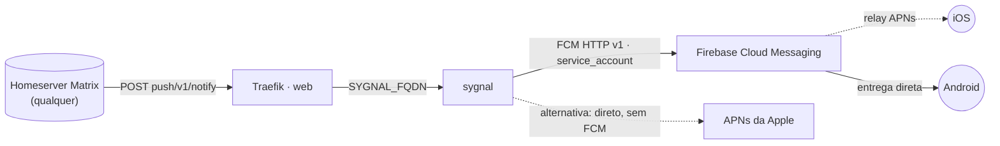

# sygnal — push gateway de referência do Matrix.org

**Sygnal** publicado via Traefik v3 com TLS. Recebe `POST /_matrix/push/v1/notify` de
**qualquer** homeserver Matrix e entrega o push de fato via **Firebase Cloud Messaging**
(Android direto; iOS por relay FCM → APNs) e/ou direto na **APNs** da Apple. Não é
específico de nenhum app — serve qualquer cliente Matrix que registre um pusher HTTP
apontando pra esta stack (Element, FluffyChat e forks, clientes próprios, etc.).

A stack não guarda estado (sem banco, sem volume): quem muda de app/projeto é o
Docker config `sygnal_config` (regras de `apps:`) e a credencial `sygnal_fcm_credential`.

## Arquitetura



## Variáveis de ambiente
| Variável | Obrigatória | Default | Descrição |
|---|---|---|---|
| `SYGNAL_FQDN` | sim | — | domínio público do gateway (ex.: `push.exemplo.com`) |
| `SYGNAL_IMAGE_TAG` | não | `v0.17.0` | tag da imagem `matrixdotorg/sygnal` |
| `SYGNAL_CONFIG_NAME` | não (Swarm) | `sygnal_config_v1` | nome do Docker config com `sygnal.yaml` |
| `SYGNAL_FCM_CREDENTIAL_NAME` | não (Swarm) | `sygnal_fcm_credential_v1` | nome do Docker config com o service account do Firebase |
| `SYGNAL_CONFIG_FILE` | não (standalone) | `./config/sygnal.yaml` | caminho local do `sygnal.yaml` (bind mount) |
| `SYGNAL_FCM_CREDENTIAL_FILE` | não (standalone) | `./config/firebase-service-account.json` | caminho local da credencial (bind mount) |
| `SYGNAL_EXTERNAL_PORT` | não | `8105` | porta no host, só se habilitar o acesso direto (bloco `ports:` comentado) |
| `PROXY_NET` | não | `web` | rede externa do Traefik |

## Pré-requisitos
- **Hardware mínimo:** 0.25 vCPU · 128 MB RAM · 1 GB disco
- **Hardware ideal:** 0.5 vCPU · 256 MB RAM · 2 GB disco
- Traefik (stack `balancer`) e rede `web` ativos.
- DNS de `SYGNAL_FQDN` apontando para o host.
- Um **projeto Firebase** com Cloud Messaging habilitado para o app que vai receber o
  push (gratuito, 1 projeto por app/organização, não por instalação do Sygnal).
- Se o app tiver usuários iOS: a **APNs Authentication Key** (`.p8`) da conta Apple
  Developer precisa estar cadastrada nesse projeto Firebase (Project Settings → Cloud
  Messaging → "Apple app configuration"). Isso é feito **no Firebase Console**, não
  nesta stack.
- Duas credenciais preparadas a partir dos `.example` em `config/` (ver abaixo):
  1. `sygnal.yaml` — com o `app_id` (ou prefixo + `*`) e o `project_id` do seu app.
  2. `firebase-service-account.json` — gerado em Firebase Console → Project Settings
     → Service Accounts → "Generate new private key". **Nunca** commitar o arquivo
     real (só os `.example` com placeholders vão pro repo).

### Docker Swarm (`type: 2`) — criar os Docker configs antes do deploy
```bash
cp config/sygnal.yaml.example sygnal.yaml                     # edite os placeholders
cp config/firebase-service-account.json.example firebase-service-account.json  # substitua pelo arquivo REAL baixado do Firebase
docker config create sygnal_config_v1 sygnal.yaml
docker config create sygnal_fcm_credential_v1 firebase-service-account.json
rm sygnal.yaml firebase-service-account.json   # não deixe as credenciais soltas no disco
```
Config é imutável: para mudar depois, crie uma nova versão (ex. `sygnal_config_v2`),
aponte `SYGNAL_CONFIG_NAME`/`SYGNAL_FCM_CREDENTIAL_NAME` pra ela e redeploy a stack.

### Standalone (`type: 3`)
```bash
cp config/sygnal.yaml.example config/sygnal.yaml                                   # edite os placeholders
cp config/firebase-service-account.json.example config/firebase-service-account.json  # substitua pelo arquivo REAL
docker network create web   # se ainda não existir
```
Aqui dá pra editar `config/sygnal.yaml` direto e só reiniciar o container — sem passo
de "versão imutável".

## Uso
1. No app Matrix, registre o pusher (`POST /_matrix/client/v3/pushers/set`) com
   `kind: http` e `data.url` = `https://<SYGNAL_FQDN>/_matrix/push/v1/notify`.
2. Confirme nos logs (`docker service logs <stack>_sygnal` / `docker compose logs -f`)
   que a notificação chegou e foi despachada (`dispatch_notification` sem erro de
   "unknown app ID" nem de credencial do FCM).
3. Teste ponta a ponta com um evento real antes de liberar para usuários.

## Troubleshooting
| Sintoma | Causa | Ação |
|---|---|---|
| Push nunca chega, sem erro visível no app | app registrou pusher com `gatewayUrl` vazio/errado | conferir se o app está apontando pro `SYGNAL_FQDN` certo |
| Log mostra "Got notification for unknown app ID" | `app_id` do pusher não casa com nenhuma chave em `apps:` | revisar o `app_id` real enviado pelo cliente e o padrão/glob em `sygnal.yaml` |
| Log mostra "Got notification for an ambiguous app ID" | duas chaves em `apps:` casam com o mesmo `app_id` (glob sobreposto) | revisar os padrões, deixar só um casando |
| Erro de autenticação/credencial do FCM | `service_account_file` errado, vazio ou projeto Firebase sem Cloud Messaging habilitado | regenerar a service account e recriar o Docker config (nova versão) |
| iOS não recebe mas Android recebe | `.p8` da Apple não cadastrado no projeto Firebase, ou `fcm_options.apns.payload.aps` ausente | cadastrar a APNs key no Firebase Console; conferir o bloco `fcm_options` no `sygnal.yaml` |
| 404/sem TLS | fora da `web` / DNS não aponta pro host | conferir rede/labels e DNS de `SYGNAL_FQDN` |
