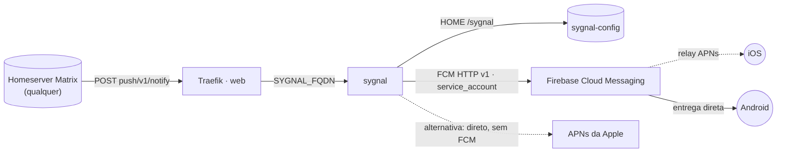

# sygnal — push gateway de referência do Matrix.org

**Sygnal** publicado via Traefik v3 com TLS. Recebe `POST /_matrix/push/v1/notify` de
**qualquer** homeserver Matrix e entrega o push de fato via **Firebase Cloud Messaging**
(Android direto; iOS por relay FCM → APNs) e/ou direto na **APNs** da Apple. Não é
específico de nenhum app — serve qualquer cliente Matrix que registre um pusher HTTP
apontando pra esta stack (Element, FluffyChat e forks, clientes próprios, etc.).

**Autocontido:** a config e a credencial do FCM vivem num volume (`sygnal-config`)
montado em `/sygnal` — dentro dele ficam `/sygnal/sygnal.yaml` (regras de `apps:`,
`project_id`) e `/sygnal/firebase-service-account.json`.

⚠️ **O Sygnal não tem um estado "vazio" tranquilo.** Ele recusa iniciar sem pelo menos
1 app válido em `apps:` (sai com `RuntimeError: No app IDs are configured`) e valida a
credencial do FCM na inicialização, não só quando vai usar (sai se o arquivo não
existir ou não for um JSON de service account válido). Um volume novo nasce vazio, então
**popule-o antes do primeiro deploy** (ver *Uso*) — assim ele nunca entra em loop de
restart por falta de config.

## Arquitetura



## Variáveis de ambiente
| Variável | Obrigatória | Default | Descrição |
|---|---|---|---|
| `SYGNAL_FQDN` | sim | — | domínio público do gateway (ex.: `push.exemplo.com`) |
| `SYGNAL_IMAGE_TAG` | não | `v0.17.0` | tag da imagem `matrixdotorg/sygnal` |
| `WORKER_HOSTNAME` | não (Swarm) | — | fixa o nó em cluster multi-worker (o volume é local ao nó) |
| `SYGNAL_EXTERNAL_PORT` | não | `8105` | porta no host, só se habilitar o acesso direto (bloco `ports:` comentado) |
| `PROXY_NET` | não | `web` | rede externa do Traefik |

## Pré-requisitos
- **Hardware mínimo:** 0.25 vCPU · 128 MB RAM · 1 GB disco
- **Hardware ideal:** 0.5 vCPU · 256 MB RAM · 2 GB disco
- Traefik (stack `balancer`) e rede `web` ativos.
- DNS de `SYGNAL_FQDN` apontando para o host.
- Um **projeto Firebase** com Cloud Messaging habilitado para o app que vai receber o
  push (gratuito, 1 projeto por app/organização, não por instalação do Sygnal).
- Se o app tiver usuários iOS: a **APNs Authentication Key** (`.p8`) da conta Apple
  Developer precisa estar cadastrada nesse projeto Firebase (Project Settings → Cloud
  Messaging → "Apple app configuration"). Isso é feito **no Firebase Console**, não
  nesta stack.
- Duas credenciais preparadas a partir dos `.example` em `config/` (ver *Uso*):
  1. `sygnal.yaml` — com o `app_id` (ou prefixo + `*`) e o `project_id` do seu app.
  2. `firebase-service-account.json` — gerado em Firebase Console → Project Settings
     → Service Accounts → "Generate new private key". **Nunca** commitar o arquivo
     real (só os `.example` com placeholders vão pro repo).

## Uso

### Recomendado: popule o volume antes do primeiro deploy (evita qualquer restart)

1. Decida o nome do stack/projeto que vai usar no deploy (ex. `sygnal`, o padrão do
   template no Portainer). Swarm e `docker compose` nomeiam o volume
   `<nome-do-stack-ou-projeto>_sygnal-config`.
2. Crie e popule o volume com **esse mesmo nome**, antes de dar deploy:
   ```bash
   cp config/sygnal.yaml.example sygnal.yaml                                     # edite os placeholders
   cp config/firebase-service-account.json.example firebase-service-account.json  # substitua pelo arquivo REAL baixado do Firebase
   docker volume create sygnal_sygnal-config   # troque "sygnal" pelo nome do stack/projeto escolhido
   docker run --rm \
     -v sygnal_sygnal-config:/data \
     -v "$PWD":/source:ro \
     alpine sh -c 'cp /source/sygnal.yaml /source/firebase-service-account.json /data/'
   rm sygnal.yaml firebase-service-account.json   # não deixe as credenciais soltas no disco
   ```
3. Deploy pela App Template do Portainer (ou `docker stack deploy` / `docker compose
   up -d`) usando o **mesmo nome** de stack/projeto do passo 1, informando `SYGNAL_FQDN`.
   Swarm/Compose reaproveitam o volume já populado em vez de criar um vazio — o Sygnal
   sobe direto com config válida, sem crashar.
4. No app Matrix, registre o pusher (`POST /_matrix/client/v3/pushers/set`) com
   `kind: http` e `data.url` = `https://<SYGNAL_FQDN>/_matrix/push/v1/notify`.
5. Confirme nos logs (`docker service logs <stack>_sygnal` / `docker compose logs -f`)
   que a notificação chegou e foi despachada (`dispatch_notification` sem erro de
   "unknown app ID" nem de credencial do FCM). Teste ponta a ponta com um evento real
   antes de liberar para usuários.

### Já fez deploy sem popular antes (container reiniciando)

Sem problema, só não evita o restart inicial:
1. Ache o nome real do volume: `docker volume ls | grep sygnal-config`.
2. Popule-o com o mesmo comando do passo 2 acima, usando esse nome.
3. Force o serviço a reler (Sygnal só lê a config na inicialização):
   `docker service update --force <stack>_sygnal` (Swarm) ou
   `docker compose restart sygnal` (standalone).

### Atualizar depois (mudar app_id/project_id/credencial)
Repita os 3 passos de popular + reiniciar acima — sobrescreve os arquivos no volume,
sem versão imutável de Docker config.

## Troubleshooting
| Sintoma | Causa | Ação |
|---|---|---|
| Container reinicia em loop com `RuntimeError: No app IDs are configured` | `apps:` vazio/ausente no `sygnal.yaml` — Sygnal recusa iniciar sem pelo menos 1 app | popular o volume com um `sygnal.yaml` válido (ver *Uso*) e reiniciar o serviço |
| Container reinicia em loop com erro de credencial/`service_account_file` | arquivo não existe no volume ou não é um JSON de service account válido — Sygnal valida isso na inicialização | popular o volume com a credencial real e reiniciar o serviço |
| Push nunca chega, sem erro visível no app | app registrou pusher com `gatewayUrl` vazio/errado | conferir se o app está apontando pro `SYGNAL_FQDN` certo |
| Log mostra "Got notification for unknown app ID" | `app_id` do pusher não casa com nenhuma chave em `apps:` | revisar o `app_id` real enviado pelo cliente e o padrão/glob em `sygnal.yaml` |
| Log mostra "Got notification for an ambiguous app ID" | duas chaves em `apps:` casam com o mesmo `app_id` (glob sobreposto) | revisar os padrões, deixar só um casando |
| Erro de autenticação do FCM só ao enviar (não no boot) | credencial válida na forma mas não autentica (service account desativado/sem permissão no projeto) | conferir o service account no Firebase Console, regenerar se preciso |
| Editei o arquivo no volume e nada mudou | Sygnal só lê a config na inicialização | reiniciar o serviço/container |
| iOS não recebe mas Android recebe | `.p8` da Apple não cadastrado no projeto Firebase, ou `fcm_options.apns.payload.aps` ausente | cadastrar a APNs key no Firebase Console; conferir o bloco `fcm_options` no `sygnal.yaml` |
| 404/sem TLS | fora da `web` / DNS não aponta pro host | conferir rede/labels e DNS de `SYGNAL_FQDN` |
