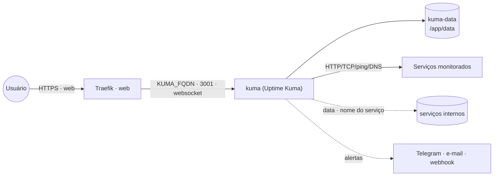
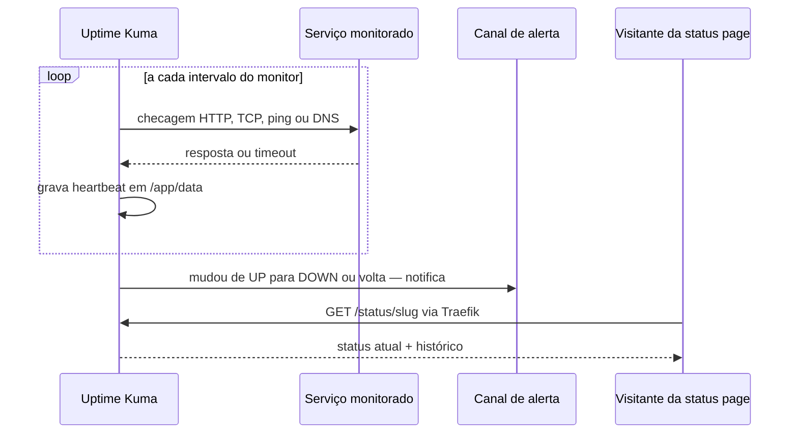

# uptime-kuma — Uptime Kuma (monitor de disponibilidade + status pages)

[Uptime Kuma](https://github.com/louislam/uptime-kuma) monitora HTTP(s), TCP, ping, DNS, keyword,
certificados, etc., envia alertas (Telegram, e-mail, webhook, Matrix, ~90 canais) e publica
**status pages**. Publicado via **Traefik v3** com TLS Let's Encrypt.

Um serviço, um volume: tudo (banco SQLite/MariaDB embutido, config, uploads) fica em
`kuma-data` → `/app/data`.

> **`uptime-kuma` vs `zabbix-status-page`:** o `zabbix-status-page` só *desenha* uma página a partir
> de um Zabbix existente. O Uptime Kuma **faz o monitoramento** sozinho e já tem status page própria.

## Arquitetura

## Fluxo

## Variáveis de ambiente

| Variável | Obrigatória | Default | Descrição |
|---|---|---|---|
| `KUMA_FQDN` | sim | — | domínio público (ex.: `status.exemplo.com`) |
| `TZ` | não | `America/Sao_Paulo` | fuso horário dos gráficos/alertas |
| `KUMA_IMAGE_TAG` | não | `2` | tag de `louislam/uptime-kuma` |
| `PROXY_NET` / `DATA_NET` | não | `web` / `data` | nomes das redes externas |

## Pré-requisitos

1. Rede externa do proxy: `docker network create web` (standalone) ou
   `docker network create --driver overlay --attachable web` (Swarm). A rede `data` só é necessária
   se você descomentar `- data` para monitorar serviços internos pelo nome.
2. Stack `balancer` (Traefik) rodando e DNS de `KUMA_FQDN` apontando para o host.

## Uso

1. Suba a stack informando `KUMA_FQDN`.
2. **Logo em seguida** acesse `https://KUMA_FQDN`: o 1º acesso escolhe o banco (SQLite basta) e
   **cria o usuário admin** — quem chegar primeiro cria a conta.
3. Crie os monitores e, se quiser, uma status page (Status Pages → New).

**Backup / migrar de host:** pare a stack e copie o volume `kuma-data` (ou use Settings → Backup).

## Troubleshooting

| Sintoma | Causa | Ação |
|---|---|---|
| Monitores somem ao recriar o container | volume montado no caminho errado (ex.: `/usr/app/data`) | o caminho da imagem é **`/app/data`** — não mude |
| UI carrega mas fica "conectando…" | websocket bloqueado no proxy | use o Traefik direto (suporta WS); evite middlewares que cortem `Upgrade` |
| 404 / certificado inválido | DNS de `KUMA_FQDN` não aponta para o host, ou rede `web` errada | confira DNS e `PROXY_NET` |
| Dados somem ao reagendar (Swarm) | volume local ao nó | fixe o serviço no nó (`WORKER_HOSTNAME`) |
| Monitor de serviço interno falha | Kuma não está na rede do alvo | descomente `- data` e use o nome do serviço |
