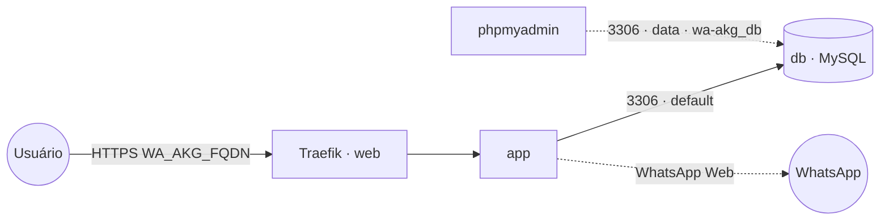

# wa-akg — WA-AKG (WhatsApp Gateway & Dashboard)

**WA-AKG** ([marcelofmatos/WA-AKG](https://github.com/marcelofmatos/WA-AKG), fork com imagem
publicada em `ghcr.io/marcelofmatos/wa-akg`) é um gateway/dashboard de WhatsApp self-hosted
(Next.js + engine Baileys): contas multi-sessão, agendamento de mensagens, auto-resposta e
integração via webhooks. Publicado via Traefik v3 com TLS, com **MySQL embarcado** (serviço `db`
próprio da stack). O banco fica na rede interna `default` e também pode ir para a `data`
(comentado) só para ferramentas de administração (phpmyadmin) o alcançarem como `wa-akg_db`.
Volumes dedicados = fácil migrar de host.

## Componentes
| Serviço | Imagem | Função |
|---|---|---|
| `app` | `ghcr.io/marcelofmatos/wa-akg` | Dashboard + API (Next.js), engine WhatsApp (Baileys), exposto via Traefik na porta 3000 |
| `db` | `mysql:8.0` | Banco de dados embarcado desta stack |

## Arquitetura

## Variáveis de ambiente
| Variável | Obrigatória | Default | Descrição |
|---|---|---|---|
| `WA_AKG_FQDN` | sim | — | domínio público (ex.: `wa.exemplo.com`) |
| `WA_AKG_AUTH_SECRET` | sim | — | chave de criptografia de sessão do NextAuth (`openssl rand -base64 32`) |
| `WA_AKG_DB_ROOT_PASSWORD` | sim | — | senha **root** do MySQL embarcado (usada também pelo app para conectar) |
| `WA_AKG_ADMIN_EMAIL` | sim | — | e-mail do usuário admin criado no primeiro boot |
| `WA_AKG_ADMIN_PASSWORD` | sim | — | senha do usuário admin criado no primeiro boot |
| `WA_AKG_DB_NAME` | não | `wa_akg` | banco usado pela aplicação |
| `WA_AKG_LOG_LEVEL` | não | `error` | nível de log do engine Baileys (`fatal/error/warn/info/debug/trace`) |
| `WA_AKG_SWAGGER_ENABLED` | não | `false` | habilita a UI do Swagger em `/docs` (mantenha `false` em produção sem `WA_AKG_SWAGGER_PASSWORD`) |
| `WA_AKG_SWAGGER_USERNAME` | não | `admin` | usuário do basic auth do Swagger (só importa se habilitado) |
| `WA_AKG_SWAGGER_PASSWORD` | não | *(vazio)* | senha do basic auth do Swagger — defina ao habilitar `WA_AKG_SWAGGER_ENABLED` |
| `WA_AKG_TZ` | não | `America/Sao_Paulo` | timezone do servidor (afeta agendamento de campanhas) |
| `WA_AKG_LOCALE` | não | `pt-BR` | locale de datas/horas na UI |
| `WA_AKG_IMAGE_TAG` | não | `latest` | tag da imagem `ghcr.io/marcelofmatos/wa-akg` |
| `WA_AKG_DB_IMAGE_TAG` | não | `8.0` | tag da imagem MySQL |
| `PROXY_NET` | não | `web` | rede externa do Traefik |
| `DATA_NET` | não | `data` | rede externa p/ ferramentas de admin alcançarem o banco |
| `WORKER_HOSTNAME` | não | — | fixa os serviços num nó (cluster multi-worker) |
| `WA_AKG_EXTERNAL_PORT` | não | `8167` | porta host p/ acesso direto ao `app` (bypass do Traefik, ver compose) |
| `WA_AKG_DB_EXTERNAL_PORT` | não | `3309` | porta host p/ acesso direto ao MySQL (bypass do Traefik, ver compose) |

## Pré-requisitos
- **Hardware mínimo:** 1 vCPU · 1 GB RAM · 10 GB disco
- **Hardware ideal:** 2 vCPU · 2 GB RAM · 20 GB disco
- Stack `balancer` (Traefik) + rede `web`; DNS de `WA_AKG_FQDN` apontando para o host.
- Rede `data`: `docker network create --driver overlay --attachable data` (só se for usar o phpmyadmin).
- Gere `WA_AKG_AUTH_SECRET` (`openssl rand -base64 32`) e defina `WA_AKG_DB_ROOT_PASSWORD`,
  `WA_AKG_ADMIN_EMAIL` e `WA_AKG_ADMIN_PASSWORD` antes do primeiro deploy.
- **Não** precisa da stack `mariadb`/`mysql` compartilhada: o banco sobe junto.

## Uso
1. Gere os segredos e faça o deploy informando `WA_AKG_FQDN`, `WA_AKG_AUTH_SECRET`,
   `WA_AKG_DB_ROOT_PASSWORD`, `WA_AKG_ADMIN_EMAIL` e `WA_AKG_ADMIN_PASSWORD`.
2. No primeiro boot o app roda `prisma db push` (cria o schema) e cadastra o usuário admin a
   partir de `WA_AKG_ADMIN_EMAIL`/`WA_AKG_ADMIN_PASSWORD`.
3. Acesse `https://WA_AKG_FQDN`, faça login com o admin e conecte um número escaneando o QR code
   na seção de sessões WhatsApp.
4. Para consumir a API via Swagger (`/docs`), habilite `WA_AKG_SWAGGER_ENABLED=true` e defina
   `WA_AKG_SWAGGER_PASSWORD`.

### Migrar para outro host
Como o banco é dedicado, basta migrar os volumes `app-data`, `uploads-data` e `db-data` para o
novo nó e subir a stack lá — sessões do WhatsApp, mídia e dados ficam preservados.

## Troubleshooting
| Sintoma | Causa | Ação |
|---|---|---|
| App reinicia em loop citando `AUTH_SECRET` | variável não definida/curta | definir `WA_AKG_AUTH_SECRET` com pelo menos 32 caracteres |
| Não consegue logar com o admin após o 1º boot | `WA_AKG_ADMIN_EMAIL`/`WA_AKG_ADMIN_PASSWORD` mudaram depois da criação inicial | o bootstrap só roda na 1ª subida; crie outro usuário pela UI ou direto no banco |
| "Access denied for user 'root'" | `WA_AKG_DB_ROOT_PASSWORD` divergente entre deploys | manter a mesma senha enquanto o volume `db-data` existir |
| QR code não conecta / sessão cai sozinha | volume `app-data` perdido (sessão Baileys) | preservar o volume `app-data` entre deploys/migrações |
| 404/sem TLS | fora da `web` / DNS não aponta | conferir rede/labels e DNS |
| phpmyadmin não acha o banco | host errado ou rede `data` não anexada ao `db` | descomentar `- data` no serviço `db` e usar `wa-akg_db:3306` |
| `/docs` (Swagger) acessível sem senha | `WA_AKG_SWAGGER_ENABLED=true` sem `WA_AKG_SWAGGER_PASSWORD` | definir a senha ou manter `WA_AKG_SWAGGER_ENABLED=false` |
